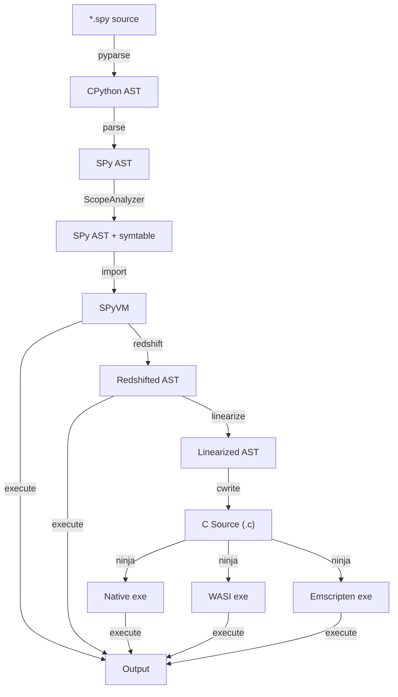

# The compilation pipeline

This page describes the phases a SPy program goes through, and the role of
WebAssembly (WASM) in the interpreter and the compiler.

## The phases



  - `pyparse`: source code → Python AST
  - `parse`: Python AST → SPy AST
  - `symtable`: analyze the SPy AST and produce a symbol table for each scope
  - `redshift`: SPy AST → redshifted SPy AST
  - `cwrite`: redshifted SPy AST → C code
  - `compile`: C code → executable

The `execute` step runs the program. It can happen right after `symtable`
(*interp mode*) or after `redshift` (*doppler mode*).

## Inspecting the pipeline

Each phase has a command that stops the compiler there and prints a
human-readable dump of the result:

```console
$ spy pyparse examples/hello.spy
$ spy parse examples/hello.spy
$ spy scopes examples/hello.spy
$ spy redshift examples/hello.spy
$ spy build --no-compile examples/hello.spy
```

## The role of WASM and `libspy`

WASM is a compilation target (WASI or Emscripten), but it is also a building
block of the interpreter. The interpreter is written in Python and runs on top
of CPython, yet it must call into `libspy`, SPy's C runtime library. To do so,
`libspy` is compiled to WASM and loaded into the Python process with
`wasmtime`.

So `libspy` is used in two very different ways:

  - **interpreted**: loaded in the Python process via `wasmtime`. This is what
    happens for `[interp]` and `[doppler]` tests, and when you run
    `spy hello.spy` or `spy execute hello.spy`.
  - **compiled**: statically linked into the final executable. This is what
    happens for `[C]` tests and when you run `spy build hello.spy`.

`libspy` consists of:

  - `spy/libspy/src`: a small C runtime library that must be statically linked
    into any SPy executable.
  - `make -C spy/libspy` builds a `libspy.a` for each supported target
    (`native`, `emscripten` and `wasi`). For `emscripten` and `wasi` it also
    builds a second `libspy.a`, used by `llwasm`, which expects the WebAssembly
    host to provide debug helpers as WASM imports. The normal `libspy.a`
    implements them in `debug.c`.
  - `spy/libspy/__init__.py`: support code that loads the WASM version of
    `libspy` in the interpreter. In particular, it implements the "WASM
    imports" that `libspy` uses to call back into the interpreter, for example
    to print debug log messages or to turn WASM panics into `SPyError`
    exceptions.

`llwasm` is a thin wrapper over `wasmtime` that makes this interaction nicer;
see [llwasm, the low-level WASM layer](llwasm.md) for the details.

### `wasmtime` vs Pyodide

Normally, SPy runs on top of CPython and uses `wasmtime` to load
`libspy.wasm`. SPy can also run on top of [Pyodide](https://pyodide.org), as in
the [playground](https://spylang.github.io/spy). There, the code is *already*
inside a WASM runtime (Emscripten), so `wasmtime` is not needed. `llwasm`
hides the difference and loads `libspy.wasm` transparently in both cases.
